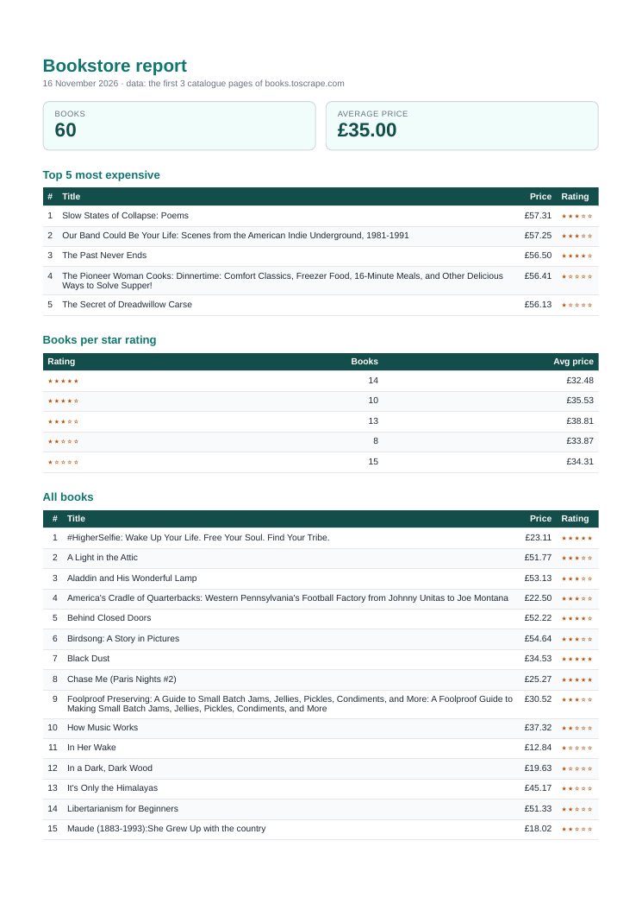

# PDF report generator

**Query → render → store → serve.** One SQL pass turns 60 rows into a handful of numbers, an HTML
template turns those numbers into a page, headless Chromium (Playwright) prints the page to a PDF,
and a FastAPI endpoint generates the file and hands it out **by link** — the JSON endpoints only ever
carry the address; only `/reports/{id}/file` moves the bytes.

## Dataset — Option B, the bookstore

The 60 validated book records collected by my polite scraper (A9) from the first three catalogue
pages of [books.toscrape.com](https://books.toscrape.com), copied into `data/books.json`.
`seed.py` loads them into `report.db`:

```sql
CREATE TABLE books (id INTEGER PRIMARY KEY AUTOINCREMENT, title TEXT, price REAL, rating INTEGER, url TEXT UNIQUE);
```

The seed deletes all rows before inserting, inside one transaction, so running it twice still
leaves exactly 60 books.

## Run it

```bash
python -m venv .venv && source .venv/bin/activate
pip install -r requirements.txt
playwright install chromium          # headless Chromium for PDF printing (~1 min, free)

python seed.py                       # -> books: 60   (safe to run again)
uvicorn app:app --port 8000
```

```bash
curl -i -X POST http://localhost:8000/reports                    # 201 + link (or 200 + today's report)
curl -i http://localhost:8000/reports/1                          # the record
curl -o my-report.pdf http://localhost:8000/reports/1/file       # the PDF itself
```

`python report_data.py` prints the report object as JSON; `python render.py` writes
`reports/test.pdf` without the API.

## API

| Method | Route | Response |
|--------|-------|----------|
| GET | `/health` | `{"status": "ok"}` |
| POST | `/reports` | **201** `{id, created_at, file}` for a new report · **200** with today's existing report · body `{"force": true}` always makes a new one |
| GET | `/reports/{id}` | the record with its file link · 404 unknown id |
| GET | `/reports/{id}/file` | the PDF (`application/pdf`) · 404 unknown id |

## The aggregation SQL (`report_data.py`)

```sql
-- total books
SELECT COUNT(*) AS n FROM books;

-- average price
SELECT ROUND(AVG(price), 2) AS avg FROM books;

-- top 5 most expensive
SELECT title, price, rating FROM books ORDER BY price DESC, title LIMIT 5;

-- books per star rating
SELECT rating, COUNT(*) AS books, ROUND(AVG(price), 2) AS avg_price
FROM books GROUP BY rating ORDER BY rating DESC;
```

Result on this data: 60 books, average £35.00, most expensive *Slow States of Collapse: Poems*
(£57.31), and 14 / 10 / 13 / 8 / 15 books at 5 / 4 / 3 / 2 / 1 stars (sums to 60).

## Page breaks

The report ends with a deliberately long table of all 60 books, so it runs to 3 A4 pages. Two print
CSS rules keep it readable across pages:

```css
tr    { break-inside: avoid; }          /* never slice a row in half */
thead { display: table-header-group; }  /* repeat the header row on every page */
```

## Proof: POST → download

```
$ time curl -i -X POST http://localhost:8000/reports
HTTP/1.1 201 Created
{"id":1,"created_at":"2026-11-16T03:50:41+00:00","file":"/reports/1/file"}
real    0m0.934s

$ curl -i -X POST http://localhost:8000/reports          # again, same day
HTTP/1.1 200 OK
{"id":1,"created_at":"2026-11-16T03:50:41+00:00","file":"/reports/1/file"}

$ curl -o my-report.pdf http://localhost:8000/reports/1/file
$ file my-report.pdf
my-report.pdf: PDF document, version 1.4, 3 page(s)

$ curl -i -X POST http://localhost:8000/reports -H 'Content-Type: application/json' -d '{"force": true}'
HTTP/1.1 201 Created
{"id":2,"created_at":"2026-11-16T03:50:42+00:00","file":"/reports/2/file"}
```

Two simultaneous POSTs (`curl ... & curl ... & wait`) also both returned `id: 1`, and `reports/`
still held exactly one file.

## Page 1 of a generated report



## When to move this out of the request

Generating takes about a second here (launching Chromium dominates), which is fine for one person
clicking one button. I would move it into a background job (enqueue, return `202` + a status link,
let the client poll) as soon as a report takes more than a couple of seconds, or several users can
trigger reports at once — every in-flight render holds a worker and a whole browser process hostage.

## Why "ask twice, get one"

The per-day check protects against double-clicks, retries after a timeout, and impatient
refreshes: the same request twice produces one effect and one file, and a lock makes sure two
*simultaneous* requests can't both decide "nothing yet" and both render. In the real world the
missing check costs money when the side effect is external — e.g. a nightly job that emails every
customer their invoice runs twice after a crash, and everyone gets two emails (or two charges).
